<h1 align="center">VR-Based Real-Time Agent</h1>

<p align="center">
  <strong>스마트폰 카메라의 2D 관절점 17개만으로 운동 자세를 실시간 채점하고,<br>
  Meta Quest 3 브라우저에 전문가 포즈와 나란히 보여 주는 VR PT 에이전트 —<br>
  3D SMPL-X 아바타 경로를 두 번 시도한 뒤 2D 관절점으로 전환해 완성한 기록</strong>
</p>

<p align="center">
  <a href="../../tree/App"><strong>최종 앱 (App)</strong></a> ·
  <a href="../../tree/Pose3D"><strong>3D 리프팅 학습 (Pose3D)</strong></a> ·
  <a href="../../tree/Avatar3D"><strong>3D 아바타 시도 (Avatar3D) ★중단</strong></a> ·
  <a href="../../tree/App/docs"><strong>Docs</strong></a> ·
  <a href="../../tree/docs-archive"><strong>재편 이전 스냅샷</strong></a>
</p>

<p align="center">
  장비 <strong>Meta Quest 3 · 스마트폰 · Windows PC</strong> · 모델 <strong>TF.js MoveNet Lightning · PoseLifterMLP (자체 학습) · SMPL-X</strong> · 수행 김건희 (전남대학교, 팀 KKLL 캡스톤 2026)
</p>

> [!NOTE]
> `main` 은 **프로젝트 입구**다 — 이 문서와 시연 그림([assets/](assets/))만 있고 코드는 없다.
> **코드는 목적별 브랜치에 있다** — 최종 앱은 [`App`](../../tree/App), 2D→3D 리프터 학습·SMPL-X 피팅은 [`Pose3D`](../../tree/Pose3D), 중단된 3D 아바타 시도는 [`Avatar3D`](../../tree/Avatar3D).
> 재편 이전 작업 공간 전체는 [`docs-archive`](../../tree/docs-archive) 에 스냅샷으로, 옛 브랜치 14개는 `archive/*` 태그로 남겼다. 어느 브랜치를 받아야 하는지는 [저장소 구조](#저장소-구조) 표를 보면 된다.

**전체 구조 한 장** — 폰이 포즈를 추정하고, 서버는 즉시 중계(relay)하면서 따로 채점(processed)하고, 헤드셋 브라우저가 두 결과를 그린다:

<p align="center">
  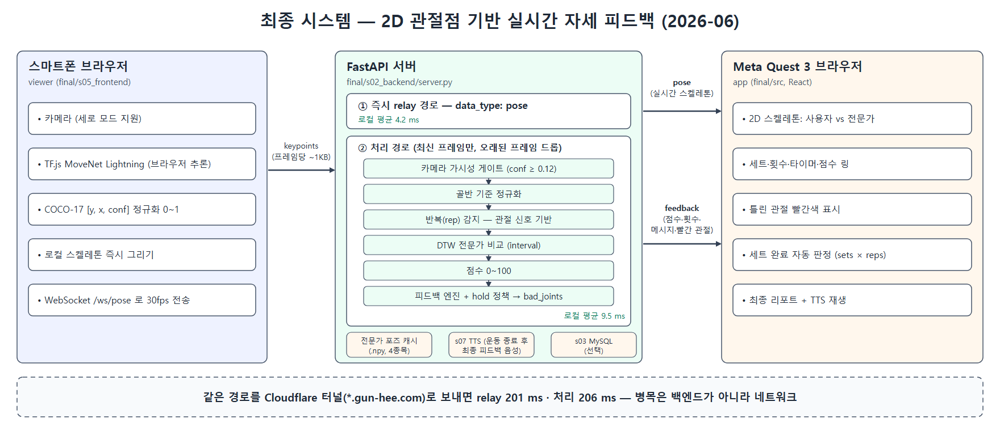
</p>

**장비로 보면** — 실제 기계는 세 대다. 카메라를 맡는 스마트폰, CPU 로 relay 와 채점을 하는 PC, 화면을 맡는 Quest 3. 같은 Wi-Fi 면 4~10 ms, Cloudflare 터널을 거치면 200 ms 다:

<p align="center">
  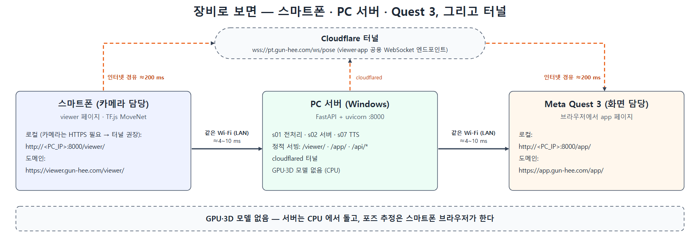
</p>

<br>

### Table of Contents

- [Highlights](#highlights)
- [시연 미리보기](#시연-미리보기)
- [연구 질문 — 3D 아바타가 필요한가, 2D 관절점이면 되는가](#연구-질문--3d-아바타가-필요한가-2d-관절점이면-되는가)
- [종목과 판정 — 4종목, 관절 신호 규칙](#종목과-판정--4종목-관절-신호-규칙)
- [1부 — 3D 아바타 경로: 왜 시작했고 왜 멈췄나](#1부--3d-아바타-경로-왜-시작했고-왜-멈췄나)
- [2부 — 2D 전환: 뷰어에서 최종 앱까지](#2부--2d-전환-뷰어에서-최종-앱까지)
- [3부 — 측정 결과](#3부--측정-결과)
- [4부 — 세대별 전환 표 G1 → G7](#4부--세대별-전환-표-g1--g7)
- [재현](#재현)
- [저장소 구조](#저장소-구조)
- [문서 찾기](#문서-찾기)
- [Citation](#citation)

<br>

### Highlights

- **2D 관절점 17개만으로 끝까지 간 최종 앱.** 서버에 GPU 도 3D 모델도 없다. 포즈 추정은 스마트폰 브라우저(TF.js MoveNet)가 하고, 서버는 CPU 에서 relay·정규화·횟수·DTW·피드백·TTS 만 한다. 세 기계가 전부 브라우저로 붙는다.
- **두 경로 분리 아키텍처.** 서버가 프레임을 받자마자 `pose` 로 중계하고, 채점은 최신 프레임만 따로 처리한다(오래된 프레임 드롭). 로컬 실측 **relay 4.2 ms · processed 9.5 ms** — 채점을 붙여도 +5 ms. 같은 경로를 Cloudflare 로 보내면 201 / 206 ms 라 **병목은 백엔드가 아니라 네트워크**임을 수치로 갈랐다.
- **3D 아바타 경로를 두 번 시도하고 원인을 특정해 배제했다.** Unity SMPL-X(4월)는 Unity 에디터 + SMPL-X 최적화 서버 동시 실행 시 RAM 93~98% 로 멈췄고, Three.js SMPL-X(6월)는 ①배포 체크포인트가 SMPL-X 회전이 아니라 3D 좌표를 내는 모델이었고 ②학습 데이터에 SMPL-X 정답 라벨이 없으며 ③학습·추론 카메라 도메인이 달라 전신이 25~50° 기울었다. 세 가지가 한 로그에 기록돼 있다.
- **2D→3D 리프터를 직접 학습했다.** AI허브 피트니스 자세 17,105 / 9,010 샘플, 4층 512-dim MLP, **val MPJPE 10.08 cm**(285 epoch — 라벨이 cm 단위라 예전 문서의 "mm" 는 오기). 관절당 10 cm 오차는 아바타를 세우기엔 거칠었고, 더구나 서버는 이 가중치를 실제로는 한 번도 싣지 못하고 있었다(1부).
- **횟수·피드백은 문장이 아니라 신호 규칙이다.** 종목별 **관절 각도 한 개**로 반복을 센다(스쿼트는 엉덩이-무릎-발목 각도가 155° → 125° → 150° 를 지나면 1회). 피드백은 hold 정책으로 한 구간에 한 번만, 카메라 가시성 게이트(conf ≥ 0.12)를 못 넘으면 점수·횟수가 움직이지 않는다. 세트 × 횟수가 차면 서버가 세션을 끝낸다.
- **clone 하나로 돈다.** `App` 브랜치를 받아 `final/scripts/00_pipeline.ps1 -Install` 한 줄이면 설치·검증·React 빌드·서버까지 간다. 57 커밋 · 14 브랜치 이력은 `archive/*` 태그로 전부 보존했다.

<br>

### 시연 미리보기

**최종 앱 (App 브랜치, 2026-10-12 캡처)** — Quest 3 브라우저에 뜨는 화면 세 장. `App` 브랜치를 그대로 띄우고(DTW 포함) 전문가 스쿼트 256 프레임을 사용자 입력으로 30fps 로 흘려 넣어 Playwright 로 찍었다.

| 운동 선택 | 운동 중 | 결과 |
|---|---|---|
| 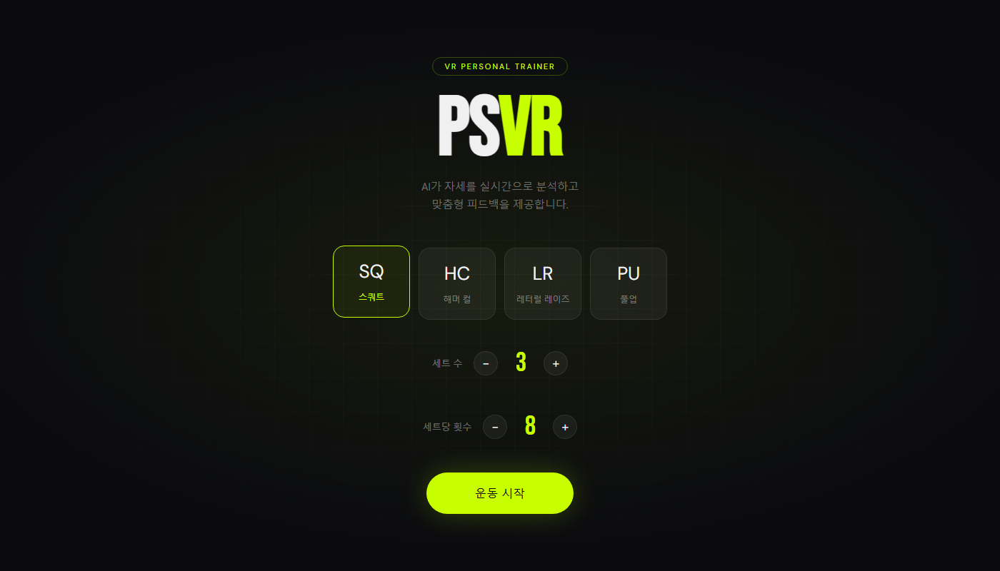 | 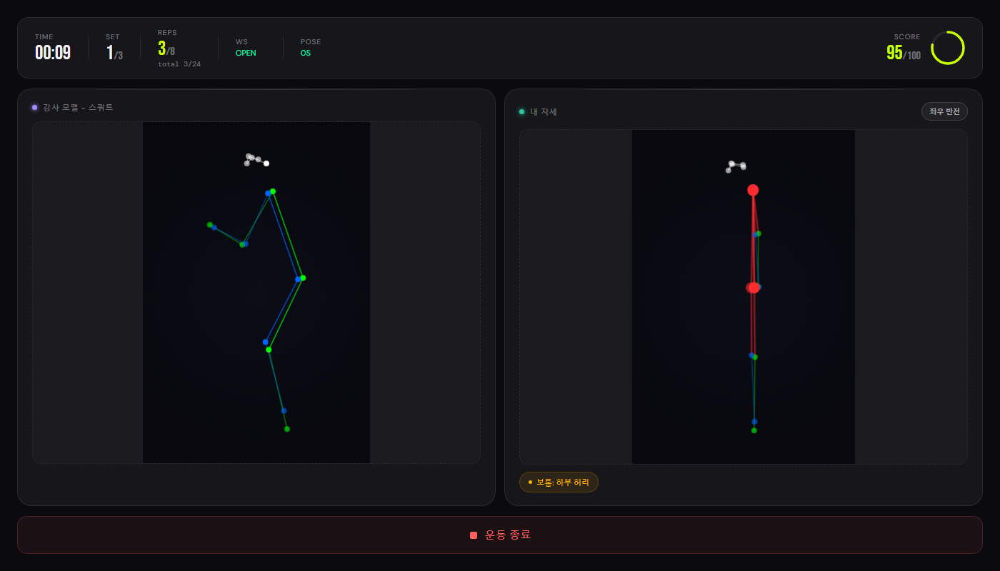 | 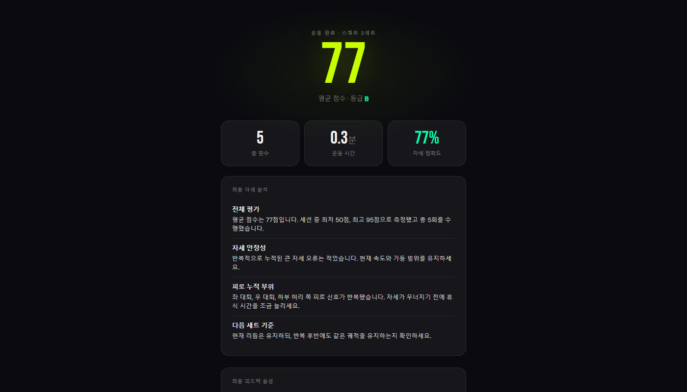 |
| 4종목(SQ·HC·LR·PU) · 세트 수 · 세트당 횟수 → 서버에 `session_config` 로 전송 | 왼쪽 **강사 모델**, 오른쪽 **내 자세**. 상단 HUD 에 TIME · SET 1/3 · REPS 1/8 · SCORE 83. 틀린 관절(상체)은 **빨간 점·선**, 아래 칩에 교정 문장 "상체를 조금 더 자연스럽게 숙여주세요" | 평균 점수·등급(81 · B+), 총 횟수·시간·정확도, **최종 자세 분석** 5항목(전체 평가 · 가장 자주 흔들린 부위 · 반복된 교정 포인트 · 피로 누적 부위 · 다음 세트 기준), 아래에 TTS 음성 |

**2D 전환점 (2026-04-29)** — Unity 를 빼고 브라우저 Canvas 로만 그린 첫 2D 뷰어. 전문가 포즈 · 실시간 피드백(점수 링, 근육 피로도) · 사용자 포즈 3패널. 왼쪽은 2배속 GIF, 오른쪽은 6월 8일 같은 뷰어의 119 FPS 화면.

| 2D 뷰어 화면 녹화 (2배속) | 2D 뷰어 — 전문가 · 피드백 · 사용자 |
|---|---|
| 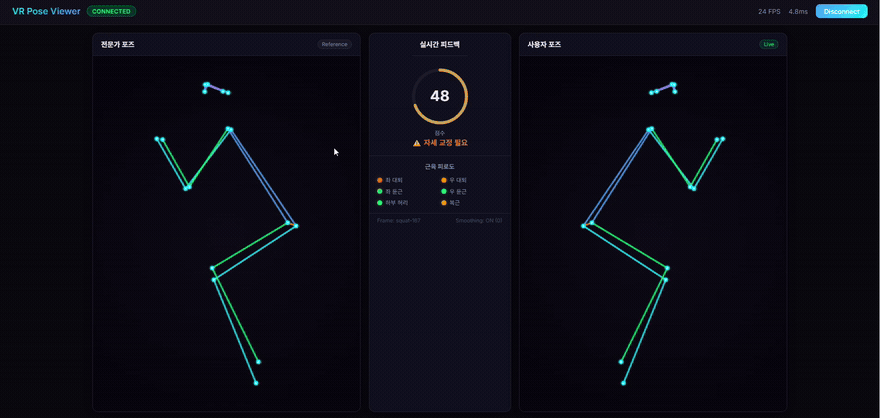 | 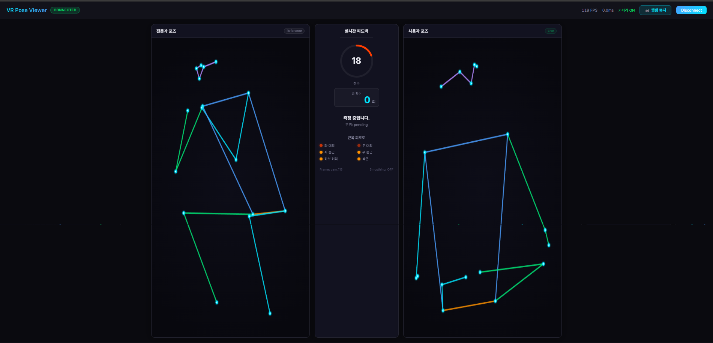 |
| 점수 76 "주의: 부하 증가 중", 좌/우 대퇴 주황. 이 구조가 그대로 최종 앱의 좌우 패널이 됐다 (이 시점 서버 점수는 `75 + frame%20 − 10` 플레이스홀더였고, 실제 분석은 관절 각도 기반 근육 피로도뿐이다) | 상단 119 FPS · 0.0 ms 는 응답 간격 기반 표시값이지 처리량 측정이 아니다. 근육 피로도 6부위, Frame cam_115 |

**3D 아바타 경로 ★중단 (2026-04 Unity → 2026-06 Three.js)** — 서버가 보낸 63+3 axis-angle 을 SMPL-X 아바타에 직접 매핑한 Unity 시연(2배속)과, 6월에 브라우저에서 다시 시도한 Three.js SMPL-X 비교 화면.

| Unity SMPL-X 아바타 (04-12, 2배속) | Unity 좌표 기반 구동 (04-13, 2배속) |
|---|---|
| 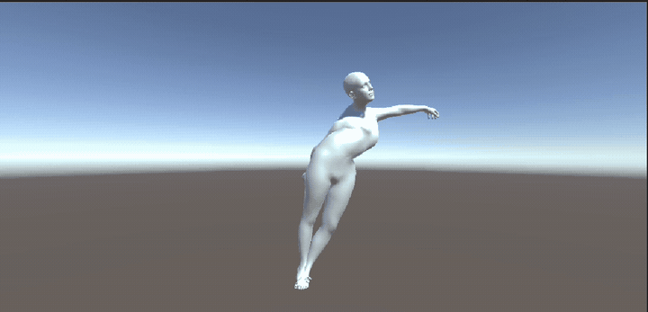 | 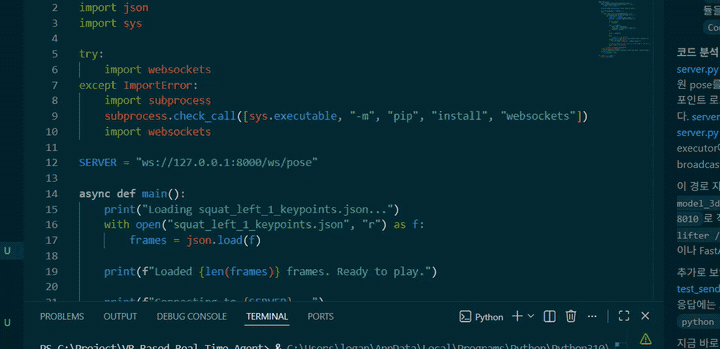 |
| 서버 MLP 출력 → `QuatFromRodrigues` → 본 회전. 몸통이 기울고 팔이 꺾이는 것이 보인다 | 같은 입력을 좌표 기반으로 구동한 비교 시연 |

| Three.js — 강사 모델 vs 내 자세 (06-08) | Three.js — 렌더링 방식 3종 비교 (06-08) |
|---|---|
| 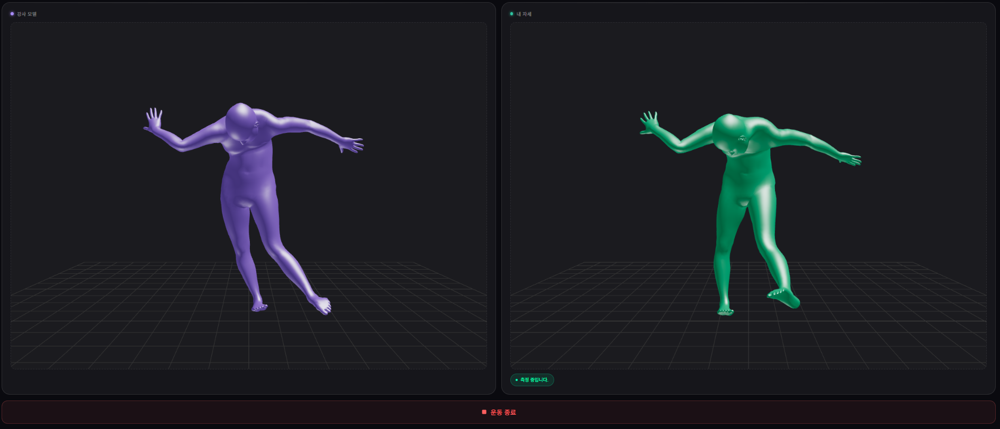 | 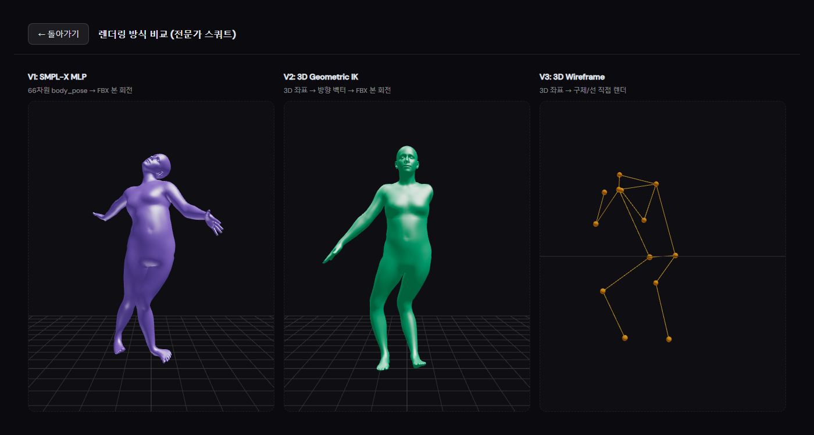 |
| 보라 = 강사(SMPL-X 메시), 초록 = 사용자. 자세가 맞지 않는다 — 체크포인트가 SMPL-X 파라미터 모델이 아니었다 | V1 SMPL-X MLP(66차원 body_pose → FBX 본) · V2 3D 좌표 → 기하 IK · V3 3D 좌표 → 구체/선 와이어프레임. V3 만 자세가 유지된다 |

**지연 — 로컬 vs Cloudflare** (90 프레임 @30fps, 2026-06-13). 막대 = 평균, 수염 = P95. 로그 축.

<p align="center">
  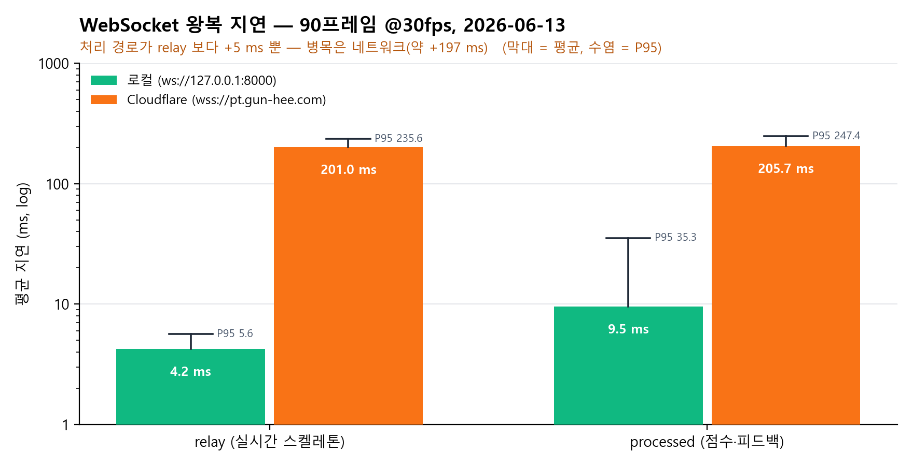
</p>

미리보기 GIF 는 전부 2배속이다. 출처 — 2D 뷰어 녹화: `1차 2d 녹음.mp4`(04-29) · Unity 두 컷: `첫 아바타 녹음 실험.mp4`(04-12) · `카톡 좌표 기반 영상.mp4`(04-13) · 스크린샷 원본은 `Avatar3D` 브랜치 `docs/30_스크린샷/`(15장) 과 `Pose3D` 브랜치 `docs/50_스크린샷/` · 최종 앱 세 장은 `App` 브랜치의 `final/app_dist` 를 로컬 서버로 띄워 Playwright 로 캡처. [assets/](assets/) 에는 본문에 안 쓴 전체 해상도 컷([2D 뷰어 점수 68, 04-29](assets/viewer2d_score_20260429.png) · [3D 웹앱 랜딩, 06-08](assets/web3d_landing_psvr_20260608.png))도 있다.

<br>

### 연구 질문 — 3D 아바타가 필요한가, 2D 관절점이면 되는가

기획 단계(2026-03)의 목표는 "Meta Quest 3 + 외부 카메라로 운동 자세를 실시간 분석하고 즉시 교정하는 VR PT 에이전트" 였고, 자연스럽게 **헤드셋 안에 3D 아바타를 세우는 것**을 전제로 출발했다. SMPL-X 바디 모델, 2D→3D 리프팅, Unity 아바타가 4월의 전부였다.

**연구 질문: VR 헤드셋 안에서 지연 없이 자세를 교정하려면 3D 아바타가 필요한가 — 아니면 2D 관절점만으로 같은 피드백이 가능한가.**

답은 2D 였다. 판단 근거는 세 가지다:

| | 3D 아바타 경로 | 2D 관절점 경로 |
|---|---|---|
| 실시간성 | SMPL-X 최적화 ≈540 ms/프레임, MLP 로 바꿔도 Unity 동시 실행 시 OOM | 서버 relay 4.2 ms · processed 9.5 ms (실측), 뷰어 표시 FPS 119(응답 간격 기반 표시값) |
| 정확성 | 3D 좌표 val MPJPE ≈10 cm — 관절당 평균 10 cm 오차. 게다가 **SMPL-X 회전 파라미터로는 변환 불가**(정답 라벨 없음) | 전문가 포즈와 같은 2D 공간에서 DTW · 관절 각도 비교 — 변환 손실 없음 |
| 피드백 | 아바타가 기울면 "어디가 틀렸는지"를 읽을 수 없다 | 틀린 관절을 **빨간 점**으로 바로 찍는다 |

> [!IMPORTANT]
> 3D 를 포기한 것이 아니라 **지금 데이터로는 성립하지 않는다**고 판정한 것이다. AI허브 피트니스 데이터셋의 정답은 3D 관절 좌표(24관절 x,y,z)뿐이고 SMPL-X `body_pose`(63차원 local axis-angle)가 없다. 좌표에서 계층적으로 회전을 근사해 재학습까지 했지만(val_loss 0.08), 추론 시 전신이 25~50° 기울었다. 되살리려면 AMASS 같은 SMPL-X 정답 데이터나 SMPLify-X 라벨링이 먼저다 — [`Avatar3D`](../../tree/Avatar3D) 브랜치 `docs/00_왜_중단했나.md`.

지키는 원칙 두 가지:

1. **좌표 규약은 하나다** — 폰·서버·앱 전부 COCO-17 `[y, x, confidence]` 정규화 0~1. 좌우 반전은 그릴 때만 하고, 폰 세로 모드 회전은 폰 화면에서만 한다. 서버로 가는 페이로드는 절대 돌리지 않는다.
2. **실시간 경로에는 무거운 것을 두지 않는다** — relay 는 받은 즉시 보내고, DTW 는 interval 로, 채점은 최신 프레임만. 느려질 수 있는 것(최종 분석·TTS)은 운동이 끝난 뒤로 민다.

<br>

### 종목과 판정 — 4종목, 관절 신호 규칙

종목은 네 개, 전문가 영상은 종목당 한 편이며 서버 기동 시 `.npy` 캐시로 올라간다 (`final/assets/expert_videos/`):

| 종목 | id | 반복(rep) 신호 — 관절 각도 하나 | 준비 → 목표 → 복귀 (°) | 전문가 영상 |
|---|---|---|---|---|
| 스쿼트 | `squat` | 엉덩이-무릎-발목 각도 (감소 방향) | 155 → 125 → 150, 최소 가동 25 | `squat_full.mp4` → `squat_full.npy` |
| 해머 컬 | `hammer_curl` | 어깨-팔꿈치-손목 각도 (감소) | 145 → 75 → 135, 최소 가동 55 | `hammer_curl.mp4` → `.npy` |
| 풀업 | `pullup` | 어깨-팔꿈치-손목 각도, 양쪽 평균 (감소) | 140 → 95 → 130, 최소 가동 35 | `pull_up.mp4` → `.npy` |
| 레터럴 레이즈 | `lateral_raise` | 엉덩이-어깨-손목 각도, 양쪽 평균 (**증가**) | 30 → 70 → 40, 최소 가동 35 | `lateral_raise.mp4` → `.npy` |

각도 임계값은 `final/s01_preprocessing/rep_rules.py` 한 곳에 있고, 정면/측면(`front` · `side_left` · `side_right`)에 따라 한쪽 다리·팔만 쓰거나 양쪽을 평균한다. 판정은 서버 한 곳에서만 한다 (`final/s01_preprocessing`):

```text
카메라 가시성 게이트 (conf ≥ 0.12, 가장자리 여유 0.01)   ← 못 넘으면 countable=false, 점수·횟수 정지
  → 골반 기준 정규화 (체형 차이 제거)
  → 반복 감지 (종목별 관절 각도 임계값 + 최소 가동 범위)
  → DTW 전문가 비교 (interval, 최신 프레임만)
  → 점수 0~100
  → 피드백 엔진 → 부위·심각도·bad_joints   (hold 정책: 한 구간에 한 번)
  → 세션 진행 (sets × reps_per_set 가 차면 completed=true → 앱이 자동 종료)
```

앱의 횟수 표시는 서버 값을 그대로 쓴다. 프론트에 더미 카운터를 두지 않는 것이 규칙이다 — 세트·횟수가 따로 노는 버그를 한 번 겪고 서버 단일 출처로 박았다.

<br>

### 1부 — 3D 아바타 경로: 왜 시작했고 왜 멈췄나

#### 출발: SMPL-X 최적화 피팅 → MLP 리프터 (2026-04-08 ~ 09)

[`Pose3D`](../../tree/Pose3D) 브랜치 `model_3d/`. 2D 키포인트(MoveNet 17관절)에서 SMPL-X 파라미터를 Adam 으로 직접 최적화하는 `OptimizationPoseFitter` 가 첫 경로였다. 동작은 했지만 프레임당 **≈540 ms** — 실시간은 불가능했다. 그래서 2D→3D 를 한 번에 회귀하는 `PoseLifterMLP`(4층, 512-dim, GELU+LayerNorm, MSE, AdamW)를 AI허브 **013 피트니스 자세** 데이터로 학습했다:

| 런 | 데이터 | epoch | best val MPJPE (cm) | 최종 val MPJPE | train MPJPE | 비고 |
|---|---|---|---|---|---|---|
| `fitness_full` (배포) | 17,105 / 9,010 | 285 (early stop) | **10.08** @245 | 10.21 | 7.5 | ~17~22k samples/s, GPU |
| `v3_pose3d` (06-08 재학습) | 같음 | 128 | 10.82 @123 (저장된 체크포인트는 val loss 최저인 epoch 88, MPJPE 10.88) | 11.10 | 9.2 | 3D 좌표 경로 재확인용 |
| `v2 smplx_lifter` (06-08) | 좌표 → 계층적 local 회전 근사 | 209 (best) | val_loss 0.08 | — | — | **추론 시 25~50° 기울어짐** |

<p align="center">
  
</p>

> [!WARNING]
> **MPJPE 의 단위는 cm 다.** 학습 라벨(AI허브 013 `-3d.json`)이 Y-up · cm(코 y ≈ 154, 엉덩이 y ≈ 94)이고 변환 없이 그대로 회귀했으므로, 4월 문서들의 "MPJPE 10.2 mm" 는 단위 오기다 (2026-10-12 라벨·체크포인트 출력으로 재확인). 관절당 평균 10 cm 는 "쓸 만한 3D 좌표" 라기엔 거친 값이다.

리프터는 ~5 ms 로 빨랐다. 그러나 **출력이 17×3 좌표**라는 점, 그리고 서버가 그 가중치를 실제로 싣지도 못하고 있었다는 점이 두 달 뒤 Three.js 실패의 뿌리가 된다.

#### 전환 1: Unity SMPL-X 아바타 (2026-04-11 ~ 29) — OOM

[`Avatar3D`](../../tree/Avatar3D) 브랜치 `unity_integration/`. 처음엔 17관절 좌표에서 IK 로 Humanoid 뼈대를 돌리려 했으나(570줄), 공식 SMPL-X Unity 패키지를 찾아 **서버의 63 `body_pose` + 3 `global_orient` 를 `QuatFromRodrigues` 로 직접 매핑**하는 쪽으로 다시 썼다(330줄). 오른손 좌표계(SMPL-X) → 왼손 좌표계(Unity) X축 반전, Slerp 보간, `rootRotationOffset(0,90,0)`, Snap-to-ground 까지 갔다.

멈춘 이유는 메모리다. **Unity 에디터 + SMPL-X 최적화 서버를 같이 띄우면 페이지 파일 93~98%** — 서버를 MLP 리프터 모드로 바꿔 RAM 을 1/10 로 줄였지만, 그 시점에 "브라우저로만 되지 않나"가 더 빠른 길로 보였다. 04-29 커밋 메시지가 그대로 남아 있다: *"웹 연결 3d 아닌 2d 환경에서 구현 unity 없이 웹에서만 구현된 상태"*.

#### 전환 2: Three.js SMPL-X 재시도 (2026-06-08) — ★배제

2D 앱이 돌아가던 6월, 헤드셋 안의 3D 를 한 번 더 시도했다 (`Avatar3D` 브랜치 `app_3d_web/`, `viewer_3d_web/`). SMPL-X FBX 를 Three.js 로 올리고 서버 파라미터로 본을 돌리는 세 방식을 나란히 만들었다 — 위 "렌더링 방식 3종 비교" 화면이다. 7개 실험을 하루에 돌리고 원인을 세 층으로 특정했다:

| 층 | 무엇이 문제였나 | 어떻게 확인했나 |
|---|---|---|
| 체크포인트 | 배포 체크포인트는 `PoseLifterMLP`(17×3 → 17×3 **좌표**, 마지막 층 51)인데 서버는 이를 `strict=False` 로 `PoseLifterNet`(17×3 → 66 **SMPL-X 파라미터**)에 올리고 있었다. 2026-10-12 재확인: 이 로드는 파라미터 18개 중 **0개**를 바꾼다 — "Weights loaded successfully" 를 찍고는 **초기화 가중치**로 돌고 있었다 | 출력을 global_orient 로 해석하면 항상 X축 −40° — 강제로 0 을 넣어야 섰다 |
| 데이터 | 013 데이터셋엔 SMPL-X `body_pose` 정답이 없다. 3D 좌표에서 계층적 local 회전을 근사해 v2 를 재학습(val_loss 0.08)했지만 추론 시 25~50° 기울어짐 | 학습 카메라 5대 고정 vs 추론 카메라 상이 — 도메인 불일치 |
| 구조 | 3D 좌표로 본을 직접 돌리는 방향 A 는 SMPL-X 가 **parent 기준 local 회전**이라 성립하지 않는다. `parent.getWorldQuaternion()` 이 Three.js SkinnedMesh 에서 프레임마다 전 프레임 값을 돌려준다 | 하체(무릎·고관절)만 부분 성공, 상체 붕괴 |

좌표 변환 자체는 맞췄다 — Unity `SMPLX.cs` 를 분석해 Three.js 에서 축을 `(rx, −ry, −rz)` 로 놓아야 함을 확인했고, FBX 22개 본 이름도 정확히 매핑했다(22/22). 그런데도 자세가 서지 않았으므로 **원인은 렌더가 아니라 모델과 데이터**라고 결론 내리고 같은 날 2D 로 돌아갔다. 전문은 `Avatar3D` 브랜치 `docs/20_Three.js_SMPLX/01_실험_로그_2026-06-08.md`.

<br>

### 2부 — 2D 전환: 뷰어에서 최종 앱까지

#### 2D 웹 뷰어 (2026-04-29) — 전환점

`model_3d/server_app` 의 FastAPI 가 정적 파일을 서빙하고 Quest 브라우저가 `http://<PC_IP>:8000/viewer/` 로 붙는다. Canvas 에 COCO-17 스켈레톤을 그리고, 점수 링·근육 피로도 히트맵·전문가 vs 사용자 좌우 패널이 이때 생겼다. 서버 쪽엔 OneEuro 필터 + 속도 클램핑(`pose_retargeting.py`, min_cutoff 1.0 · beta 0.007 · 0.5 rad/frame)을 넣어 MLP 의 프레임 간 떨림을 잡았다. 프레임당 ~1 KB, 같은 Wi-Fi 에서 체감 지연 10~30 ms.

#### final/ 재편 (2026-05-21 ~ 23)

루트에 흩어진 코드를 지우고 `final/` 아래 역할별로 다시 세웠다 — `s01_preprocessing`(정규화·반복·DTW·점수·피드백, 팀원의 전처리 코드를 경로만 바꿔 통합) · `s02_backend`(FastAPI) · `s03_database`(MySQL, 선택) · `s05_frontend`(폰 viewer) · `s07_tts`. 전문가 영상 의존성을 `전처리 2/` 에서 떼어 `final/assets/` 로 옮긴 것도 이때다.

#### 최종 앱 (2026-06-04 ~ 14)

브랜치 `FOR-VR-APP → latency-2d-realtime-baseline → last-dance → tts → main` 순으로 열흘. 무엇이 바뀌었나:

| 날짜 | 무엇을 했나 | 왜 |
|---|---|---|
| 06-04 | VR 앱 지연 최적화 · 세션 동기화 | 앱이 피드백에 묶여 끊김 |
| 06-09 | **relay / processed 경로 분리**, 최신 프레임만 처리 | 실시간 스켈레톤과 채점을 떼어 놓아야 지연이 안 쌓인다 |
| 06-09 | 반복 규칙을 관절 신호로 (`rep_detector` · `rep_rules` · `rep_signals`), 세트·횟수 서버 단일 출처 | 피드백 문장 기반 카운트는 종목마다 흔들렸다 |
| 06-12 | 최종 피드백 TTS · 피로 부위 → **빨간 관절** | 운동 뒤엔 지연 부담이 없으니 자세히 |
| 06-13 | 카메라 가시성 게이트(0.12) · 관대한 점수 정규화 · 피드백 hold · 좌우 반전 토글 | 전신이 안 잡힌 프레임이 점수를 흔들었다 |
| 06-13 | **지연 측정 스위트** (`latency_lab`) — 로컬 vs Cloudflare | "느리다"를 숫자로 |
| 06-14 | 폰 세로 모드 · 전문가 `.npy` 축 자동 판별 · `sets × reps` 자동 종료 · `00_pipeline.ps1` | 인수인계 전 마지막 정리 |

해결한 문제 일곱 가지는 `App` 브랜치 `docs/10_실행/01_트러블슈팅.md` 에 원인·수정으로 정리돼 있다 (앱 끊김 · DTW 비용 · 도메인 WebSocket 호스트 · CSP 모델 차단 · `confidence_joints` 버그 · 과한 게이트 · 옛 viewer 덮어쓰기).

<br>

### 3부 — 측정 결과

#### 지연 — 네 경로 × 두 환경 (2026-06-13, 90 프레임 @30fps, squat, 전 프레임 수신)

| 경로 | 로컬 평균 | 중앙값 | P90 | P95 | 최대 | Cloudflare 평균 | 중앙값 | P90 | P95 | 최대 |
|---|---|---|---|---|---|---|---|---|---|---|
| viewer → viewer relay 에코 | 4.03 | 2.76 | 3.73 | 5.50 | 61.2 | 203.3 | 196.6 | 235.1 | 238.2 | 274.7 |
| viewer → **app relay** | **4.24** | 2.96 | 3.90 | 5.61 | 61.3 | **201.0** | 195.2 | 231.6 | 235.6 | 270.3 |
| viewer → viewer processed | 9.29 | 5.59 | 9.26 | 35.1 | 68.8 | 207.9 | 199.3 | 238.9 | 245.7 | 276.3 |
| viewer → **app processed** | **9.51** | 5.78 | 9.50 | 35.3 | 69.2 | **205.7** | 197.5 | 238.0 | 247.4 | 272.4 |

단위 ms. 측정에서 제외한 것: 브라우저 MoveNet 추론, Canvas 렌더. 읽는 법 — processed 가 relay 보다 평균 +5 ms 뿐이라 전처리·DTW 는 병목이 아니다. Cloudflare 가 +197 ms 를 더하므로 **같은 Wi-Fi 에서 쓰는 것이 설계 전제**다. 원본: `App` 브랜치 `final/latency_lab/results/`.

#### 기획 목표 대비

| 기획안 목표 (2026-03) | 결과 | 상태 |
|---|---|---|
| 운동 분류 90% ↑ (LSTM·Transformer·ST-GCN) | 분류 모델 없음 — 사용자가 앱에서 종목을 고른다 | **미구현** (범위 축소) |
| 자세 판단 85% ↑ | 점수·피드백은 작동하나 **정답 라벨 평가 없음** | 미측정 |
| 60 FPS ↑ | 폰 → 서버 전송은 66 ms 간격(≈15 fps)으로 고정, 뷰어의 "119 FPS" 는 응답 간격 기반 표시값 | **미측정** (처리량 수치 없음) |
| DTW 10 ms ↓ | processed 경로 전체 평균 9.5 ms (DTW 포함, interval) | **달성** |
| 오류 → 음성 3초 ↓ | 세트 중 음성은 없음, 실시간은 화면 칩 · 음성은 종료 후 TTS | 설계 변경 |
| LLM 피드백 5분 ↓ | LLM 대신 **결정적 최종 분석**(누적 피드백 집계) | 설계 변경 |

#### 2D 포즈 추정기 비교 (2026-04, `Pose3D` 브랜치 `experiments/`)

MediaPipe · MoveNet · MMPose 를 피트니스 데이터 부분집합에서 비교했다. 결과 문서는 `Pose3D` 브랜치 `docs/10_데이터/02_2D_포즈추정기_비교.md`. 최종 앱은 **브라우저에서 돌아가는 MoveNet Lightning** 을 택했다 — 정확도보다 "서버 없이 폰에서 30fps" 가 결정 기준이었다.

<br>

### 4부 — 세대별 전환 표 G1 → G7

<p align="center">
  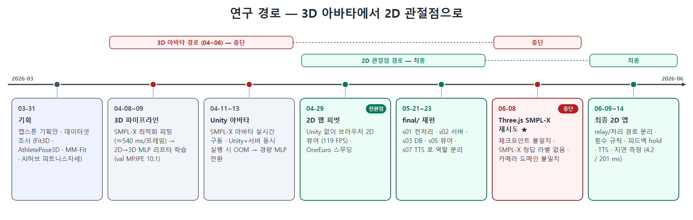
</p>

| 세대 | 기간 | 무엇을 했나 | 왜 넘어갔나 |
|---|---|---|---|
| G1 SMPL-X 최적화 피팅 | 04-08 | 2D → SMPL-X 파라미터 Adam 최적화 (15 iter) | ≈540 ms/프레임, 실시간 불가 |
| G2 MLP 리프터 | 04-09 | 2D → 3D 17관절 MLP, val MPJPE 10.08 cm | 출력이 **좌표**라 SMPL-X 회전이 아니고, 서버는 가중치를 싣지도 못했다 (06-08 에야 확인) |
| G3 Unity SMPL-X 아바타 | 04-11 ~ 29 | 63+3 axis-angle 직접 매핑, Slerp, 좌표계 변환 | Unity + 서버 동시 실행 시 RAM 93~98% |
| **G4 2D 웹 뷰어 ★전환점** | 04-29 | Unity 없이 Canvas 스켈레톤, OneEuro, Quest 브라우저 접속 | — 이후 모든 개발의 기반 |
| G5 final/ 재편 | 05-21 ~ 23 | s01~s07 역할 분리, 전처리 통합, DTW 점수 | 매 프레임 DTW 가 FPS 를 깎음 → interval |
| G6 Three.js SMPL-X ★배제 | 06-08 | FBX 본 구동 3방식 (V1 MLP 파라미터 / V2 기하 IK / V3 와이어프레임) | 체크포인트 불일치 · SMPL-X 정답 없음 · 카메라 도메인 불일치 |
| **G7 최종 2D 앱** | 06-09 ~ 14 | relay/processed 분리 · 신호 기반 횟수 · 피드백 hold · 게이트 · TTS · 지연 측정 | — 최종 |

<br>

### 재현

최종 앱은 `App` 브랜치 하나로 돈다 (Windows · Python 3.8 · Node 22). 상세는 그 브랜치 `README.md` 의 상황별 절(0 상황 판별 · A 처음 세우기 · B 하루 실행 · C 도메인 · D 지연 측정 · E 정상 출력 · F 막혔을 때).

```powershell
$R = "https://github.com/logan0741/VR-Based-Real-Time-Agent.git"
git clone -b App $R vr-pt-app ; cd vr-pt-app
Copy-Item .env.example .env                  # DB_ENABLED=false 기본, 키 없이 돈다
.\final\scripts\00_pipeline.ps1 -Install     # pip + npm 설치 → py_compile 검증 → React 빌드 → 서버
#   Quest: http://<PC_IP>:8000/app/     (종목·세트·횟수 → 운동 시작)
#   폰:    https://viewer.<내 도메인>/viewer/  — 브라우저가 localhost 가 아닌 http 에서는 카메라를
#          열어 주지 않으므로 폰은 Cloudflare 터널(HTTPS)로 붙인다 (App 브랜치 README §C)
.\final\scripts\04_latency_check.ps1         # 지연 측정 → final/latency_lab/results/
```

2D→3D 리프터 학습과 SMPL-X 피팅은 `Pose3D` 브랜치 (conda, CUDA, SMPL-X 모델 파일과 AI허브 데이터는 라이선스상 직접 받아 둔다):

```bash
git clone -b Pose3D https://github.com/logan0741/VR-Based-Real-Time-Agent.git vr-pt-pose3d && cd vr-pt-pose3d
conda env create -f environment.yml && conda activate vr-real-time-agent
python -m model_3d --check-all                                  # 더미 · pose3d 직접 · SMPL-X 좌표 피팅 · 리프터 4종 점검
python -m model_3d.train_fitness_lifter --epochs 800 --device cuda   # → model_3d/artifacts/training/<run>/ 에 곡선·지표
```

깃허브에 못 올리는 것은 **데이터셋·바디 모델·체크포인트·영상·자격증명** 다섯뿐이며, 위치는 각 브랜치 `docs/00_환경_준비/00_처음_시작.md` 에 있다.

<br>

### 저장소 구조

#### GitHub 브랜치

**목적별로 나뉘어 있다. 하나만 받으면 그 일은 끝까지 된다** (2026-10-12 재구성).

| 브랜치 | 무엇을 하나 | 시작점 |
|---|---|---|
| **[`App`](../../tree/App)** | **최종 실시간 자세 피드백 앱** — 폰 viewer · FastAPI · Quest app · TTS · 지연 측정 | **`README.md` 하나로 실행** |
| **[`Pose3D`](../../tree/Pose3D)** | **2D→3D 리프터 학습 · SMPL-X 피팅 · 첫 실시간 서버 + 2D 뷰어 · 2D 추정기 비교** | `README.md` → `docs/00~50` |
| **[`Avatar3D`](../../tree/Avatar3D)** ★중단 | Unity SMPL-X 아바타 · Three.js SMPL-X 뷰어 · 3D 웹앱(렌더 3방식) · **왜 중단했나** | `docs/00_왜_중단했나.md` |
| [`docs-archive`](../../tree/docs-archive) | 재편 이전 작업 공간 전체 스냅샷 (팀원 전처리 코드 · 실험 기록 · 스크린샷 · 옛 루트 스크립트). 실행용 아님 | 옛 경위를 찾을 때 |
| `main` | 프로젝트 입구 (이 문서 + `assets/`). 코드 없음 | — |

```powershell
R = https://github.com/logan0741/VR-Based-Real-Time-Agent.git
git clone -b App      $R vr-pt-app       # 실행
git clone -b Pose3D   $R vr-pt-pose3d    # 학습·분석 (GPU)
git clone -b Avatar3D $R vr-pt-avatar3d  # 3D 시도 기록
# ★폴더 이름은 아무거나 좋다 — 스크립트는 자기 위치에서 저장소 뿌리를 찾는다 (final/scripts/*.ps1 의 $PSScriptRoot\..\..).
#   한 컴퓨터에 세 브랜치를 나란히 두려면 git worktree 를 쓴다: git worktree add _wt_App App
```

세 브랜치는 `.gitignore` 를 공유하고, 각각 `README.md`(상황별 실행) + `docs/NN_…`(막혔을 때 원인 찾기) 구조다. **한쪽 내용이 필요하면 그 브랜치의 문서를 본다. 코드를 가져다 섞지 않는다** — `App` 의 서버는 `final/` 아래 상대 경로를 전제로 하고, `Pose3D` 의 서버는 루트의 `model_3d/` 를 전제로 한다.

#### 정리된 브랜치 — 태그로 보존 (2026-10-12)

재구성 전 브랜치 14개의 마지막 커밋을 `archive/<브랜치>` 태그로 남겼다 (`git checkout archive/tts` 처럼 언제든 꺼낼 수 있다). 브랜치 자체는 지우지 않았다 — 지워도 태그로 복구된다.

| 태그 | 기간 | 무엇이었나 |
|---|---|---|
| `archive/gunhee` | 03-31 ~ 04-08 | FastAPI 서버 설정 · `model_3d` 시작 |
| `archive/smpl-x-test,-logic` | 04-08 ~ 04-29 | SMPL-X 피팅 · 리프터 학습 · Unity 아바타 · **2D 뷰어 전환** (G1~G4) |
| `archive/For_Test1` | 05-21 ~ 23 | `final/` s01~s07 재편 (G5) |
| `archive/FOR-VR-APP` · `archive/For_Tesst1` | 06-04 | VR 앱 지연 최적화 · 세션 동기화 |
| `archive/latency-2d-realtime-baseline` | 06-09 | 저지연 2D 경로 안정화 |
| `archive/last-dance` | 06-09 | 실시간 파이프라인 완성 · 세트/횟수 동기화 · 횟수 규칙 분리 |
| `archive/tts` | 06-12 ~ 13 | TTS · 빨간 관절 · 카메라 게이트 · 피드백 hold · 최종 패키징 (G7) |
| `archive/main-pre-reorg-20261012` | 06-14 | 재구성 직전 `main` (`final/` 코드가 main 에 있던 상태) |
| `archive/bokyung` · `archive/front` · `archive/gyubo` · `archive/kyeongho` · `archive/red` · `archive/feature/pose-keypoint-visualization` | 03 ~ 06 | 팀원 브랜치 (README 정리 · 디자인 · 테스트 · 전문가 영상 에셋 · 초기 설정) |

#### 깃에 없는 것

| 무엇 | 어디서 | 어디에 두나 |
|---|---|---|
| AI허브 013 피트니스 자세 데이터셋 | AI허브 | `Pose3D` 루트 `013.피트니스자세/` |
| SMPL-X 바디 모델 (`models_smplx_v1_1.zip`) · SMPL-X Unity 패키지 · `smplx.fbx` | smpl-x.is.tue.mpg.de (라이선스 동의) | `smplx_locked_head/` · Unity 프로젝트 · `viewer_3d_web/public/` |
| 리프터 체크포인트 (`*.pt`, 9.7 MB) | 학습으로 재생성 (`Pose3D`) | `model_3d/artifacts/checkpoints/` |
| 전문가 원본 영상 · 시연 녹화 원본 | 로컬 보관 | `final/assets/expert_videos/` 는 예외로 커밋됨 |
| `.env` (OpenAI 키 · DB 비밀번호) | `.env.example` 을 복사 | 각 브랜치 루트 |

<br>

### 문서 찾기

| 브랜치 · 폴더 | 무엇을 찾을 때 | 대표 문서 |
|---|---|---|
| `App/README.md` | **실행은 이것 하나로** — 상황 판별 · 처음 세우기 · 하루 실행 · 도메인 · 지연 측정 | |
| `App/docs/00_환경_준비/` | 아무것도 없는 PC 에서 · Cloudflare 터널 | `00_처음_시작.md` · `01_도메인_터널.md` |
| `App/docs/10_실행/` · `20_판정_규칙/` | 하루 운영 · 트러블슈팅 7건 · 좌표 규약 · 횟수 규칙 · 피드백과 결과 | `01_트러블슈팅.md` · `02_횟수_규칙.md` |
| `App/docs/30_지연_측정/` · `40_기록/` | 측정 방법과 전체 표 · 인수인계 기록 (05-21 HANDOFF · last-dance 파이프라인) | `01_측정_방법과_결과.md` |
| `App/final/*.md` | 코드 옆 설계 문서 — 아키텍처 · 컴포넌트 구조 · 인수인계 | `FINAL_ARCHITECTURE.md` · `REPORT_SYSTEM_STRUCTURE.md` |
| `Pose3D/docs/10_데이터/` · `20_학습/` | 데이터셋 · 2D 추정기 비교 · 리프터 학습 · SMPL-X 피팅과 좌표계 | `01_리프터_학습.md` · `02_SMPLX_피팅과_좌표계.md` |
| `Pose3D/docs/30_실시간_서버/` · `40_분석_기록/` | 첫 서버 + 2D 뷰어 · 4월 분석 문서 전량 (`PROJECT_ANALYSIS` · `CHANGELOG` · 심층 분석) | `01_서버와_2D뷰어.md` |
| `Avatar3D/docs/` | **왜 중단했나** · Unity 컨트롤러 가이드 · Three.js 실험 로그 · 렌더 3방식 · 스크린샷 16장 | `00_왜_중단했나.md` · `20_Three.js_SMPLX/01_실험_로그_2026-06-08.md` |
| `docs-archive` | 재편 이전 그대로 — 팀원 전처리 코드(`전처리/` · `전처리 2/`) · 판정 변형(`versions/`) · 루트 스크린샷·Playwright 스크립트 | 루트 |

<br>

### Citation

```bibtex
@misc{kim2026vrposeagent,
  title        = {VR-Based Real-Time Agent: 2D Keypoint Real-Time Posture Feedback for VR Personal Training,
                  with a Documented Pivot from SMPL-X 3D Avatars},
  author       = {Kim, Gunhee},
  year         = {2026},
  howpublished = {\url{https://github.com/logan0741/VR-Based-Real-Time-Agent}},
  note         = {Capstone project, Chonnam National University (team KKLL). App branch: runnable system; Pose3D: 2D-to-3D lifter; Avatar3D: discontinued 3D avatar line}
}
```
