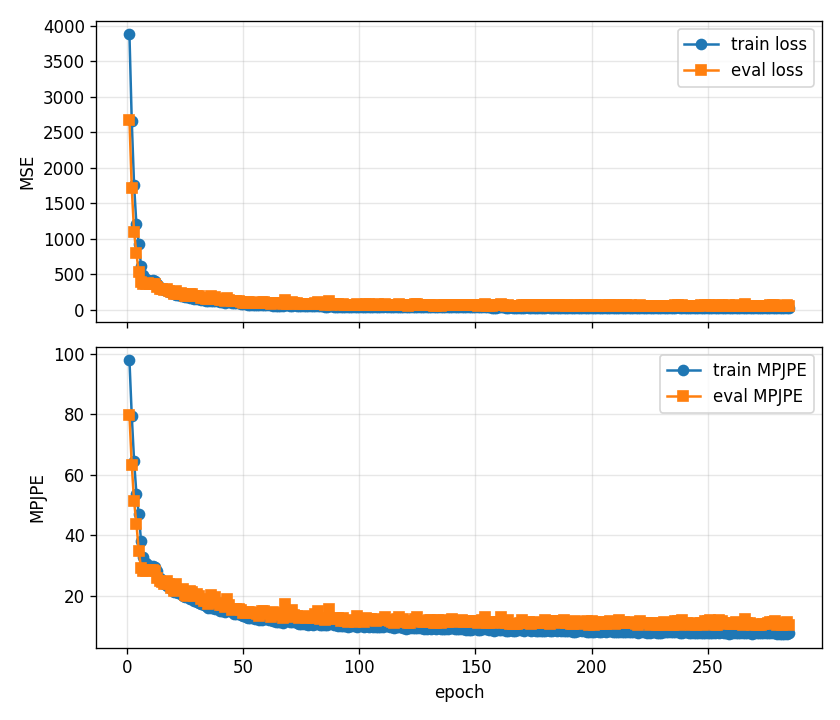

# 리프터 학습 — PoseLifterMLP (2D 17×3 → 3D 17×3)

## 1. 모델

`model_3d/lifter_model.py PoseLifterMLP`

```text
입력 17×3 [x/W, y/H, conf] → flatten 51
→ [Linear(·,512) → LayerNorm → GELU → Dropout 0.1] × 4
→ Linear(512, 51) → reshape 17×3   (3D 관절, 데이터셋 좌표·cm)
```

- 손실: `nn.MSELoss` (좌표 제곱 오차 평균). 지표: MPJPE (관절별 유클리드 거리 평균, cm).
- 옵티마이저: AdamW, lr 1e-3, weight_decay 1e-4. 배치 256.
- 조기 종료: 검증 **loss** 가 `best - 1.0` 아래로 40 epoch 동안 내려가지 않으면 멈춘다. best 체크포인트도 검증 loss 기준이다 (MPJPE 기준이 아니다).
- 이름이 "residual MLP" 라고 docstring 에 적혀 있지만 실제 코드에 잔차 연결은 없다.
- 프레임 하나만 본다 (시간 문맥 없음). 떨림은 서버의 `PoseRetargeter` 가 사후에 줄인다.

## 2. 명령

```powershell
# 환경·데이터 확인 (train_samples=17105, val_samples=9010 이 나와야 한다)
powershell -ExecutionPolicy Bypass -File .\scripts\check_fitness_training_env.ps1

# 전체 학습 (데이터 경로 자동 탐색)
python -m model_3d.train_fitness_lifter --epochs 800 --device cuda
# 같은 것을 PowerShell 래퍼로
powershell -ExecutionPolicy Bypass -File .\scripts\train_fitness_full.ps1 -Epochs 800 -Device cuda
# 밤새 돌리기 (-MaxHours 로 시간 상한, 기본 0 = 무제한)
powershell -ExecutionPolicy Bypass -File .\scripts\train_fitness_overnight.ps1 -MaxHours 8
# 학습 → --check-all → Unity 내보내기 일괄
powershell -ExecutionPolicy Bypass -File .\scripts\run_fitness_to_unity.ps1 -Epochs 800

# 1분 스모크 (CPU)
python -m model_3d.train_fitness_lifter --epochs 1 --max-files 2 --eval-max-files 1 --batch-size 16 --device cpu --checkpoint model_3d\artifacts\checkpoints\fitness_pose_lifter_smoke.pt --artifacts-dir model_3d\artifacts\training\fitness_smoke_launcher

# 평가만 — eval-only 도 끝에 --checkpoint 경로로 체크포인트를 다시 저장하고(epoch 0, optimizer 없음)
# --artifacts-dir 에 지표·곡선을 쓴다. 기본값이면 커밋된 fitness_full/ 을 덮어쓰므로 복사본과 별도 폴더로 돌린다.
copy model_3d\artifacts\checkpoints\fitness_pose_lifter_latest_best.pt model_3d\artifacts\checkpoints\eval_copy.pt
python -m model_3d.train_fitness_lifter --eval-only --checkpoint model_3d\artifacts\checkpoints\eval_copy.pt --artifacts-dir model_3d\artifacts\training\eval_only
```

주요 옵션 (`train_fitness_lifter.py`): `--epochs 800`, `--batch-size 256`, `--lr 1e-3`, `--hidden-dim 512`, `--num-layers 4`, `--dropout 0.1`, `--max-files 0`(0 = 전체), `--max-hours 0`(0 = 무제한), `--early-stop-patience 40`, `--early-stop-min-delta 1.0`, `--checkpoint`, `--best-checkpoint`, `--artifacts-dir`.

나오는 것:

| 파일 | 커밋 여부 |
| --- | --- |
| `model_3d/artifacts/checkpoints/fitness_pose_lifter_latest.pt` (마지막 epoch) | gitignore (약 10 MB) |
| `model_3d/artifacts/checkpoints/fitness_pose_lifter_latest_best.pt` (검증 loss 최소) | gitignore |
| `model_3d/artifacts/training/fitness_full/pose_lifter_metrics.json` | 커밋됨 |
| `model_3d/artifacts/training/fitness_full/pose_lifter_training_curve.png` | 커밋됨 |

체크포인트는 `{model_state, optimizer_state, epoch, config, metrics}` 딕셔너리로 저장된다 (`save_lifter_checkpoint`).

## 3. 결과

데이터 `013.피트니스자세/prepared_train_eval_body01_compact`, 학습 17,105 / 검증 9,010 샘플, CUDA. 값은 `model_3d/artifacts/training/*/pose_lifter_metrics.json` 에서 읽었다.

| 실행 | 모델 | epoch | best 검증 MPJPE | 저장된 best 체크포인트 | 최종 검증 MPJPE / loss | 최종 학습 MPJPE | samples/s |
| --- | --- | --- | --- | --- | --- | --- | --- |
| **`fitness_full`** (배포) | PoseLifterMLP | 285 / 800 (조기 종료) | **10.08** @ epoch 245 | epoch 245 (loss 51.5) | 10.21 / 53.3 | 7.57 | 약 16.7k–27.0k |
| `v3_pose3d` (2026-06-08) | PoseLifterMLP | 128 | 10.82 @ epoch 123 | epoch 88 (loss 57.8, MPJPE 10.88) | 11.10 / 61.0 | 9.02 | 약 15.0k–27.8k |
| v2 (`train_smplx_v2.py`) | PoseLifterNet 17×3 → 66 | — | — | best_epoch 209, val_loss 0.08 | — | — | — |

- `fitness_full` 의 best 체크포인트가 epoch 245 인 것은 체크포인트 파일 안의 `epoch` 값으로도 확인했다 (2026-10-12).
- `v3_pose3d` 는 MPJPE 최저(epoch 123)와 저장된 best(epoch 88, loss 최저)가 다르다. 실험 로그의 "Best epoch 88, MPJPE 10.87" 은 저장된 체크포인트 쪽을 말한 것이다.
- v2 수치는 [docs-archive 의 3d_avatar_experiment_log.md](https://github.com/logan0741/VR-Based-Real-Time-Agent/blob/docs-archive/3d_avatar_experiment_log.md) 실험 5 에서 옮겼다 (문서상 수치, 지표 json 없음). v2 의 val_loss 는 axis-angle 파라미터의 MSE 라서 위 MPJPE 와 비교할 수 없다.
- 그 밖의 폴더(`fitness_budget_test`, `fitness_scripted`, `fitness_smoke*`, `fitness_verified`, `fitness_workflow_smoke`, 루트의 `pose_lifter_metrics.json`)는 스크립트 동작 확인용 짧은 실행 기록이다.



### 단위에 대한 정정

[model_3d_deep_analysis.md](../40_분석_기록/model_3d_deep_analysis.md) 와 실험 로그는 "MPJPE 10.2mm", "10.87mm" 라고 적었다. 그러나 코드는 3D 라벨을 변환 없이 타깃으로 쓰고, 라벨은 cm 단위다 (Nose 높이 평균 약 160). 그래서 **MPJPE 10.08 은 약 10 cm** 다. 2026-10-12 에 배포 체크포인트를 검증 3개 파일(240 샘플)에 다시 돌려 MPJPE 8.5 를 얻었고, 이 값도 cm 규모와 맞는다 (전체 검증셋 재측정은 아님).

### 학습–검증 간격

- 끝에서 학습 MPJPE 7.6, 검증 10.2. 검증 loss(약 51–53)가 학습 loss(약 25.6)의 두 배다.
- 검증은 학습에 없는 촬영 그룹(4번) 하나뿐이다. 같은 Day·같은 카메라 배치에서 사람만 바뀐 셈이라, 다른 카메라·다른 환경(웹캠)에서의 정확도는 이 숫자로 알 수 없다.
- 타깃이 루트 정렬(골반 중심) 없이 데이터셋 절대 좌표라서, 오차에 전신 위치 오차가 섞여 있다. 관절 상대 위치만의 오차는 이보다 작을 수 있다 (측정 안 함).
- v2 에서 이 카메라 도메인 문제가 global_orient 25–50° 기울어짐으로 드러났다 ([02_SMPLX_피팅과_좌표계.md](02_SMPLX_피팅과_좌표계.md)).

## 4. v2: SMPL-X 파라미터를 직접 내는 재학습 (중단)

```powershell
python model_3d/prepare_smplx_dataset.py   # 013 3D 관절 → 계층적 local axis-angle (66) → artifacts/training/smplx_v2/{train,val}.pkl
python model_3d/train_smplx_v2.py          # PoseLifterNet 재학습 → artifacts/checkpoints/v2/smplx_lifter_best.pt (500 epoch, batch 128, lr 1e-3)
```

- 1차: bone 방향의 world rotation 을 그대로 타깃으로 씀 → SMPL-X 는 parent 기준 local rotation 이라 이중 회전.
- 2차: parent world rotation 의 역 × world rotation = local rotation 으로 계층 순서대로 계산. val_loss 0.08 (best epoch 209).
- 그러나 추론 때 global_orient 가 25–50° 기울었다. 학습 데이터(고정 카메라 5대)와 추론 입력(다른 카메라)의 도메인 불일치로 판단했다.
- global_orient 는 학습 타깃에서 [0,0,0] 으로 고정되어 있다 (`prepare_smplx_dataset.py` docstring).
- 근본 해결안으로 AMASS(SMPL-X GT 포함) 재학습, SMPLify-X 로 GT 추출, 단순 IK 가 거론되었으나 실행하지 않았다.

출처: [3d_avatar_experiment_log.md (docs-archive)](https://github.com/logan0741/VR-Based-Real-Time-Agent/blob/docs-archive/3d_avatar_experiment_log.md) 실험 5·6.
