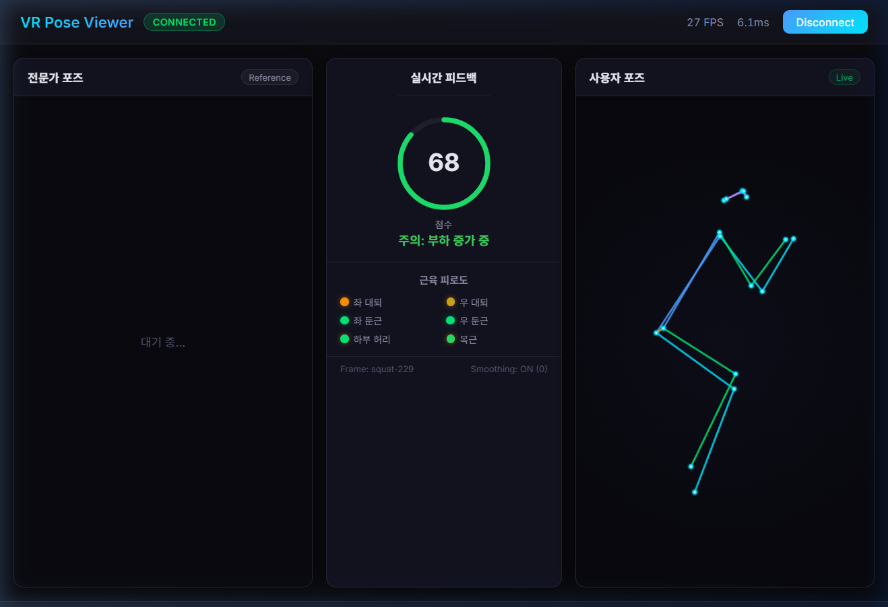

# 실시간 서버와 2D 뷰어

프로젝트의 첫 실시간 서버다. 나중에 [App 브랜치](https://github.com/logan0741/VR-Based-Real-Time-Agent/tree/App)의 `final/s02_backend/server.py` 로 이어졌다.

## 1. 띄우기

```powershell
copy .env.example .env               # 한 번만. DB_ENABLED=false
python run_steps.py --server         # uvicorn model_3d.server_app.server:app --host 0.0.0.0 --port 8000
python run_steps.py --server --port 8020
python run_steps.py --cloudflare     # cloudflared 가 있으면 trycloudflare 주소로 외부 공개
```

시작 로그에 `[Lifter] Pipeline Ready. Device: cuda|cpu` 가 나오면 준비된 것이다. `[DB] Disabled: ...` 는 MySQL 이 없을 때의 정상 메시지다.

| 경로 | 내용 |
| --- | --- |
| `GET /` | 뷰어가 있으면 `viewer_2d/index.html`, 없으면 서비스 정보 JSON |
| `GET /viewer/` | 2D 뷰어 (정적 파일) |
| `WS /ws/pose` | 키포인트 입력 → 응답을 **연결된 모든 클라이언트에 브로드캐스트** |
| `GET /api/expert` | 전문가 키포인트 시퀀스 (`data_samples/squat_left_1_keypoints.json` 267프레임) |
| `GET /api/health` | 상태 + DB 상태 |
| `POST /api/reset` | 스무딩 필터 초기화 |
| `POST /api/session/start`, `/api/session/end` | 운동 세션 시작/종료 (MySQL 저장) |
| `/app/` | 루트에 `dist/` 가 있을 때만. 이 브랜치에는 없다 |

## 2. 메시지

요청:

```json
{ "data_type": "keypoints", "frame_id": "squat-12", "payload": [[0.52, 0.48, 0.91], "... 17개"] }
```

`data_type` 은 `keypoints` / `session_start` / `session_end` / `reset`. payload 는 17 × `[a, b, conf]` 숫자여야 한다.

응답 (lifter 백엔드):

```json
{
  "status": "ok", "frame_id": "squat-12", "session_id": "...",
  "keypoints_2d": [[...] × 17],
  "fit": { "backend": "lifter", "global_orient": [3], "body_pose": [63] },
  "feedback": { "score": 68, "label": "주의: left_quad", "muscle_fatigue": { "left_quad": "high", "...": "low" } },
  "debug": { "inference_ms": 1.2, "smoothing_enabled": true, "smoothing_frame": 230 }
}
```

`FITTER_BACKEND=optimization` 이면 `fit` 에 SMPL-X 최적화 결과와 `joints_3d` 가 들어간다.

## 3. 서버 안쪽 (`FastPosePipeline`)

1. **PoseLifterNet** (17×3 → 66) 추론. ★ 배포 체크포인트의 가중치는 실리지 않는다 → `fit` 값은 의미가 없다 ([02_SMPLX_피팅과_좌표계.md](../20_학습/02_SMPLX_피팅과_좌표계.md) §3).
2. **PoseRetargeter** (`model_3d/pose_retargeting.py`) — 프레임마다 독립 추론이라 생기는 떨림을 줄인다.

   ```
   Raw → Velocity Clamping → OneEuro Filter → Smoothed
         (큰 점프 제거)       (적응형 저역통과)
   ```

   - 속도 제한: body_pose·joints 0.5 rad/frame, global_orient 0.25 (= `SMOOTHING_MAX_VELOCITY` × 0.5)
   - OneEuro (Casiez et al., 2012): `min_cutoff=1.0`(낮을수록 강하게 평활), `beta=0.007`(높을수록 빠른 동작에 민감), `d_cutoff=1.0`
   - 채널: body_pose 63 + global_orient 3 + joints 51, 각 채널 독립
   - 끄기·조정: `SMOOTHING_ENABLED`, `SMOOTHING_MIN_CUTOFF`, `SMOOTHING_BETA`, `SMOOTHING_MAX_VELOCITY`
3. **PostureAnalyzer** (`server_app/posture_analyzer.py`) — 입력 2D 키포인트로 스쿼트 근육 피로도를 판정한다.
   - 무릎각 < 100° → 대퇴(quad) high, 둔근 med / < 140° → quad med / 그 외 low (좌우 각각)
   - 어깨–골반 세로 거리가 골반–무릎 거리의 0.5배 미만이고 무릎각 > 110° → 하부 허리 high, 0.8배 미만 → med
   - 코어(abs) 는 허리 상태를 따라간다
   - 라벨: high 가 있으면 `주의: ...`, med 만 있으면 `보통: ...`, 없으면 `양호`
4. **점수는 자리표시자다.** `pose_score = 75 + (frame_count % 20) - 10` — 프레임 번호에 따라 65~84 를 돈다. 자세와 무관하다. 전문가와 비교한 실제 점수(DTW)는 App 브랜치에서 구현되었다.
5. `ExerciseSessionTracker` 가 세션 프레임 점수·라벨을 모아 `session_end` 때 MySQL `vr_fitness` 에 저장한다 (`DB_ENABLED=true` 이고 연결될 때만).

### 알려진 한계 (코드 읽기로 확인, 실행 검증은 하지 않음)

- 피로도 판정과 PostureAnalyzer 의 `calculate_angle` 은 `[a, b, conf]` 세 성분을 모두 좌표로 쓴다. 신뢰도가 각도에 섞인다.
- 허리 판정은 `[1]` 성분을 세로축으로 가정한다. 입력이 MoveNet `[y, x, score]` 이면 `[1]` 은 가로(x)다.
- 클라이언트마다 순서가 다르다: `webcam_client.py` 는 MediaPipe `[x, y, visibility]`, 브라우저 뷰어는 MoveNet `[y, x, score]` 를 보낸다. lifter 경로는 `KEYPOINT_FORMAT` 변환을 거치지 않는다 (이 변수는 `preprocessing.py`, 즉 오프라인 SMPL-X 경로에서만 쓰인다).

## 4. 2D 뷰어 (`viewer_2d/`)

`index.html` + `viewer.js` + `style.css`, 빌드 없음. 서버가 `/viewer/` 로 서빙한다.

| 패널 | 내용 |
| --- | --- |
| 전문가 포즈 (Reference) | `/api/expert` 시퀀스를 15fps 로 반복 재생 |
| 실시간 피드백 | 점수 링, 피드백 라벨, 근육 피로도 6칸(좌·우 대퇴, 좌·우 둔근, 하부 허리, 복근), 프레임 번호, 스무딩 상태 |
| 사용자 포즈 (Live) | 서버 응답의 `keypoints_2d` 를 Canvas 에 그림 |

- 상단 "웹캠 시작": 브라우저에서 tfjs `pose-detection` MoveNet SinglePose Lightning 으로 포즈를 뽑아 약 30fps(33 ms 간격)로 서버에 보낸다. 사용자 패널은 서버 왕복을 기다리지 않고 바로 그린다.
- 상단 FPS 는 **서버 응답을 받은 간격의 역수를 최근 30개 평균**한 값이다. 지연(ms)은 응답의 `debug.inference_ms` 를 그대로 보여 준다. 둘 다 종단 지연 측정이 아니다.
- Quest 3: PC 와 같은 Wi-Fi 에서 Quest 브라우저로 `http://<PC_IP>:8000/viewer/` 를 연다. 프레임당 데이터는 약 1 KB 다 ([PROJECT_ANALYSIS.md](../40_분석_기록/PROJECT_ANALYSIS.md) §4, "같은 Wi-Fi 지연 10~30 ms" 는 문서상 추정).

### 화면 기록

| 날짜 | 화면 | 값 |
| --- | --- | --- |
| 2026-04-29 |  | `play_squat.py` 재생(`Frame: squat-229`), 27 FPS, 6.1 ms, 점수 68, "주의: 부하 증가 중", Smoothing ON, 전문가 패널 "대기 중" |
| 2026-06-08 |  | 브라우저 웹캠 모드, **119 FPS**, 0.0 ms, 3패널 모두 표시, 점수 18, Smoothing OFF |

119 FPS 는 실험 로그(2026-06-08)의 "2D 뷰어 119 FPS, 0.0 ms latency" 와 같은 화면이다. 위 FPS 계산 방식 때문에 처리량 측정값으로 인용하지 않는다. 6월 화면에는 이 브랜치 뷰어에 없는 "총 횟수"·"부위" 칸이 있고 점수 18 은 이 브랜치 서버의 자리표시자 범위(65~84) 밖이다. 즉 이후 App 쪽 서버·뷰어로 찍은 화면이다 — 이 브랜치 코드로 그대로 재현되지 않는다.

## 5. 클라이언트

| 명령 | 입력 | 보내는 형식 |
| --- | --- | --- |
| `python tools/play_squat.py --loops 2` | `data_samples/squat_left_1_keypoints.json` 267프레임, 약 30fps | 파일의 keypoints 그대로 |
| `python tools/test_debug.py` | 고정 17점 1프레임 | `[y, x, score]` 형태 값, 응답을 출력 |
| `python -m model_3d.server_app.clients.webcam_client` | PC 웹캠 + MediaPipe Pose (33점 → COCO 17) | `[x, y, visibility]` |
| `python -m model_3d.server_app.clients.video_client --video <mp4>` | 영상 + MediaPipe | 골반 중심·몸통 400 px 로 맞춘 1920×1080 가상 캔버스 픽셀 `[x, y, z깊이]` |
| `python -m model_3d.server_app.clients.dataset_client` | `pose_3d_v3/valid.pkl` 재생 30fps | 데이터셋 2D |
| `python -m model_3d.server_app.clients.test_send_keypoints` | 50프레임 합성 | 연결 확인 |
| 브라우저 뷰어 "웹캠 시작" | tfjs MoveNet Lightning | `[y, x, score]` |

모든 클라이언트는 `ws://127.0.0.1:8000/ws/pose` 로 고정되어 있다. 다른 PC 의 서버로 보내려면 각 파일의 `SERVER_URL`/`SERVER` 를 고친다.
